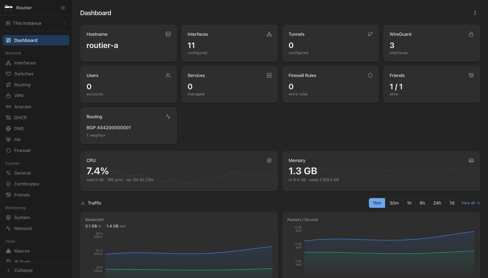
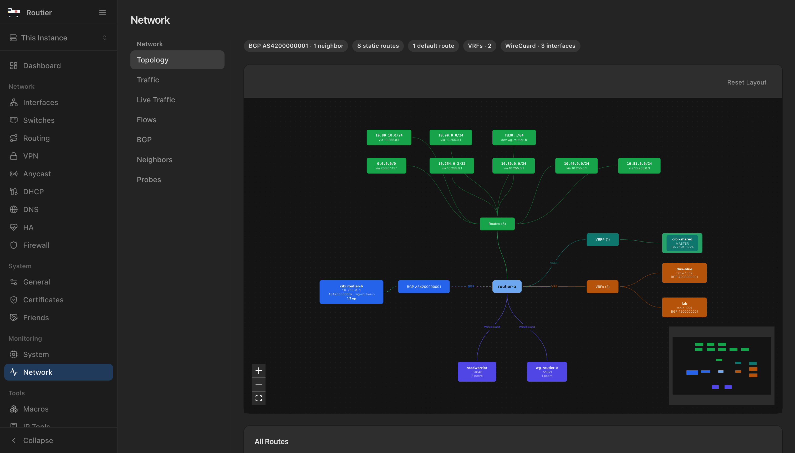
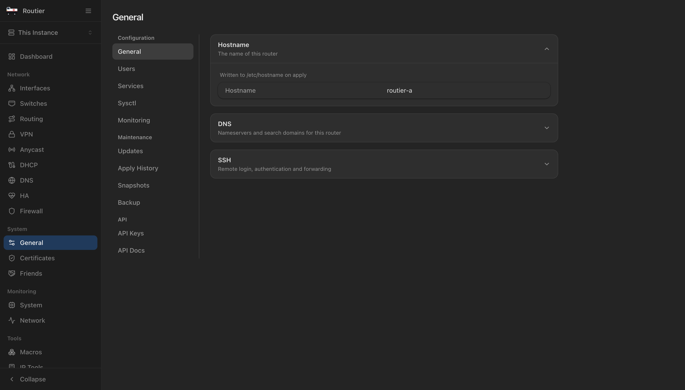

# Routier documentation

Routier turns a plain Alpine Linux box into a router and firewall that you
manage with a single YAML file. You describe the state you want (networking,
routing, firewall, services) and `routier` renders and applies it. Every apply
comes with a safety net: the previous state is snapshotted and a rollback
watchdog is armed, so even a bad firewall rule cannot lock you out of a remote
box. A web UI and an HTTP API sit on top of the same engine, and everything
they can do has a CLI equivalent.

## Routier in action

The dashboard brings interface, routing, and firewall status together with live
CPU, memory, and traffic statistics.



The interactive topology view connects the router to its BGP neighbor,
WireGuard peer, and IPv4 and IPv6 default routes.



General settings group hostname, DNS, SSH, users, services, monitoring, and
backups in one place.



## Getting started

- **[Try Routier](quickstart.md)** in a virtual machine from the installation
  ISO. Nothing to install on your own network, about ten minutes.
- **[Install it](installation.md)** on hardware, from a cloud image, or as a
  package on an existing Alpine Linux box:

  ```bash
  setup-apkrepos -c -1
  wget -qO /etc/apk/keys/routier.rsa.pub %%REPO_URL%%/routier.rsa.pub
  echo %%REPO_URL%%/nightly >> /etc/apk/repositories
  apk update && apk add routier
  ```

  The package prints the web UI address and a one-time password, and leaves
  the host's network alone until you apply and confirm a configuration.
- **[Help test it](help-test.md).** Routier is young; reports from real
  networks and hardware shape what comes next.

## How it fits together

- **Config**. One declarative YAML file (`/etc/routier/config.yml`). See
  [configuration.md](configuration.md).
- **Render**. The config is turned into concrete artifacts: interface setup,
  FRR, nftables, wg-quick, service configs.
- **Apply**. Artifacts are applied atomically with a snapshot and an armed
  rollback (`routier apply` / `POST /api/config/apply`).
- **Surfaces**. The web UI, the HTTP API, and the `routier` CLI are three views
  of the same engine and the same config.

## Documentation index

### Overview

| Page | Purpose |
|------|---------|
| [quickstart.md](quickstart.md) | try Routier in a VM from the ISO |
| [help-test.md](help-test.md) | what to test and how to report it |
| [installation.md](installation.md) | installation media, cloud images, package install, host takeover, upgrades |
| [architecture.md](architecture.md) | the load/render/apply pipeline, apply ordering, repository layout |
| [configuration.md](configuration.md) | the config model: sections, versioning, staging, apply and rollback |

### Configuration sections

| Page | Purpose |
|------|---------|
| [interfaces.md](interfaces.md) | interfaces, VLANs, bridges, VRFs |
| [routing.md](routing.md) | static routes, BGP, OSPF, BFD, PBR, anycast, router advertisements |
| [ha.md](ha.md) | high availability: VRRP failover and conntrackd state replication |
| [firewall.md](firewall.md) | the routier-owned nftables table, automatic allows, variables |
| [wireguard.md](wireguard.md) | WireGuard interfaces and peers |
| [dhcp.md](dhcp.md) | Kea DHCP subnets, pools, reservations and lease operations |
| [dns.md](dns.md) | the BIND resolver and authoritative zones (`dns.server`) |
| [switches.md](switches.md) | managed switches, models, credentials, apply and rollback |
| [system.md](system.md) | hostname, resolv.conf, SSH, sysctl, users, managed services |
| [web-tls.md](web-tls.md) | the web UI certificate: self-signed, files, or ACME |
| [friends.md](friends.md) | mutually-authenticated peer routers, liveness, derived tunnels |
| [macros.md](macros.md) | saved, reusable config fragments |

### Surfaces and operations

| Page | Purpose |
|------|---------|
| [cli.md](cli.md) | `routier` command reference |
| [api.md](api.md) | REST API v1 and the web/UI API |
| [mcp.md](mcp.md) | generic multi-instance MCP server for AI-driven configuration and monitoring |
| [monitoring.md](monitoring.md) | stats collection, live status, logs |
| [tools.md](tools.md) | address-calculation utilities (subnet, reverse, range) |

### Development

| Page | Purpose |
|------|---------|
| [building.md](building.md) | building and testing the Alpine package |
| [testing.md](testing.md) | test layout and conventions |
| [code-style.md](code-style.md) | coding rules gofmt and eslint do not enforce |
| [ui-guidelines.md](ui-guidelines.md) | web UI rules adapted from the GNOME HIG |

## AI usage

AI-assisted contributions are welcome. The project is built with tools such as
Claude Code, and contributors may use Claude, Codex or no assistant at all.
Whatever the tool, the contributor owns the result: they know what the code
does, have tested it, and can explain it. See [code-style.md](code-style.md)
for the coding style, the other rules, and how backend and frontend changes are
reviewed.
